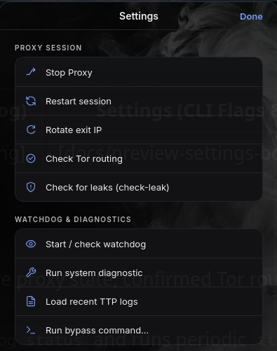

# TTP Desktop

A sleek, Unc0ver-inspired desktop controller for [TransparentTorProxy (`ttp`)](https://github.com/onyks-os/TransparentTorProxy) on Arch Linux, featuring live Tor routing readiness, a real-time leak/anomaly watchdog, full `ttp` CLI flag controls, and system tray integration.

## Previews

| Main View | Settings (Session & Watchdog) | Settings (CLI Flags & App) |
| :---: | :---: | :---: |
|  |  |  |

## Features

- **Session Readiness (`0/2` – `2/2`)**: Live tracking for active proxy state, confirmed Tor routing, Exit IP, and session uptime.
- **Live Watchdog & Anomaly Monitor**: Polls `ttp watchdog status` and runs periodic `ttp check-leak` probes while active to surface leaks, lockdown states, or routing failures immediately.
- **Full `ttp` CLI Flag Support**: Configure `--verbose` (`-v`), `--quiet` (`-q`), `--log-format` (`text` / `json`), `--require-vpn <UUID>`, and extra `start` flags directly in Settings.
- **Diagnostics & Log Export**: Run `ttp check`, `ttp check-leak`, `ttp diagnose`, `ttp logs`, and `ttp bypass`, or export timestamped session logs to a file.
- **System Tray & Frameless Dark UI**: Minimize to tray without interrupting your active TTP session.

## Requirements

- [TransparentTorProxy](https://github.com/onyks-os/TransparentTorProxy) (`transparent-tor-proxy` / `ttp` in `/usr/bin/ttp`)
- `gtk3`, `webkit2gtk-4.1`, `libappindicator-gtk3`, `python`, `python-gobject`, `sudo`

## Installation (Arch Linux)

Download `ttp-desktop-0.4.4-1-any.pkg.tar.zst` from the [Releases](../../releases) page and install:

```bash
sudo pacman -U ./ttp-desktop-0.4.4-1-any.pkg.tar.zst
