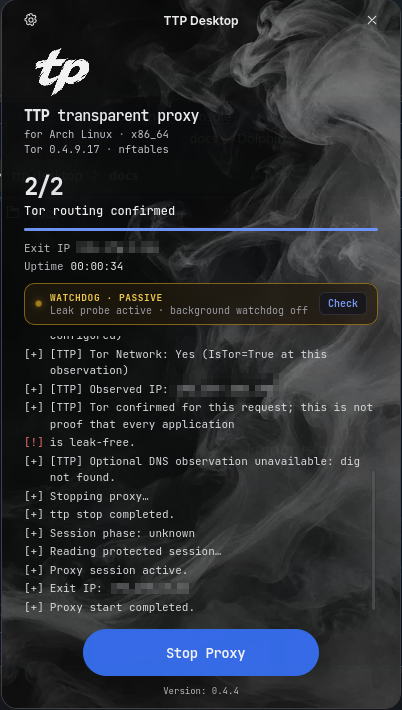
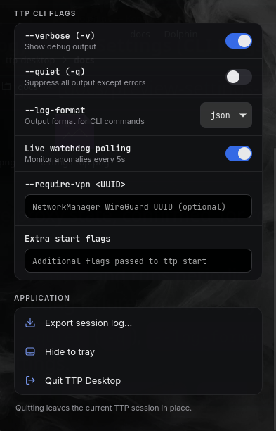

<div align="center">

# TTP Desktop

**Unc0ver-inspired dark desktop controller for [TransparentTorProxy (`ttp`)](https://github.com/onyks-os/TransparentTorProxy)**

<a href="https://github.com/crjase/TransparentTorProxy-GUI/releases"></a>
<a href="https://github.com/crjase/TransparentTorProxy-GUI/releases"></a>
<a href="https://github.com/crjase/TransparentTorProxy-GUI/releases"></a>

</div>

---

### 📸 Previews

| Main View | Settings (Session & Watchdog) | Settings (CLI Flags & Export) |
| :---: | :---: | :---: |
|  |  |  |

---

### ✨ Features

| Feature | Description |
| :--- | :--- |
| 🎨 **Unc0ver-Style UI** | Frameless smoky-ink dark window, `JetBrains Mono` telemetry, `0/2`–`2/2` Tor readiness meter & system tray |
| 🛡️ **Live Leak Watchdog** | Real-time status strip polling `ttp watchdog` and periodic `ttp check-leak` probes while active |
| ⚙️ **Full CLI Flags** | Configure `-v`, `-q`, `--log-format`, `--require-vpn <UUID>`, and custom `start` flags in Settings |
| 🔍 **Diagnostics & Bypass** | Run `check`, `check-leak`, `diagnose`, `logs`, and `bypass` commands directly from the app |
| 📋 **Logs & Export** | Live `[+]` / `[!]` terminal output when run from CLI plus one-click session log export |

---

### 📦 Installation

> [!IMPORTANT]
> Requires **[TransparentTorProxy (`ttp`)](https://github.com/onyks-os/TransparentTorProxy)** installed on your system (`/usr/bin/ttp`).

Download the package for your distro from the [Releases](https://github.com/crjase/TransparentTorProxy-GUI/releases) page:

<details open>
<summary><b>Arch Linux</b> — <code>.pkg.tar.zst</code></summary>

```bash
sudo pacman -U ./ttp-gui-0.4.4-arch-linux.pkg.tar.zst
```
> Using a manual `ttp` install instead of `transparent-tor-proxy`? Add `--assume-installed transparent-tor-proxy`.

</details>

<details>
<summary><b>Debian / Ubuntu</b> — <code>.deb</code></summary>

```bash
sudo apt update && sudo apt install ./ttp-gui-0.4.4-debian-linux.deb
```

</details>

<details>
<summary><b>Generic Linux (Fedora, openSUSE, etc.)</b> — <code>.tar.gz</code></summary>

Install runtime dependencies first (`python3-gobject`, `gtk3`, `webkit2gtk4.1`, and `libappindicator-gtk3` for tray):

- **Fedora**: `sudo dnf install python3-gobject gtk3 webkit2gtk4.1 libappindicator-gtk3`
- **openSUSE**: `sudo zypper install python3-gobject gtk3 typelib-1_0-WebKit2-4_1 typelib-1_0-AyatanaAppIndicator3-0_1`

Then install:

```bash
tar -xzf ttp-gui-0.4.4-generic-linux.tar.gz
cd ttp-desktop-0.4.4-linux
sudo ./install.sh
```

To uninstall later: `sudo ./uninstall.sh`

</details>

---

### 🛠️ Building from Source

Build the native **Tauri (Rust + Svelte)** binary directly from source:

<details>
<summary><b>1. Install build dependencies</b></summary>

- **Arch Linux**:
  ```bash
  sudo pacman -S --needed base-devel rust nodejs npm webkit2gtk-4.1 gtk3 libappindicator-gtk3
  ```
- **Debian / Ubuntu**:
  ```bash
  sudo apt install build-essential curl wget file libssl-dev libayatana-appindicator3-dev librsvg2-dev libwebkit2gtk-4.1-dev nodejs npm
  curl --proto '=https' --tlsv1.2 -sSf [https://sh.rustup.rs](https://sh.rustup.rs) | sh
  ```
- **Fedora**:
  ```bash
  sudo dnf install gcc gcc-c++ make openssl-devel webkit2gtk4.1-devel gtk3-devel libappindicator-gtk3-devel librsvg2-devel nodejs npm
  curl --proto '=https' --tlsv1.2 -sSf [https://sh.rustup.rs](https://sh.rustup.rs) | sh
  ```

</details>

<details>
<summary><b>2. Clone &amp; build</b></summary>

```bash
git clone [https://github.com/crjase/TransparentTorProxy-GUI.git](https://github.com/crjase/TransparentTorProxy-GUI.git)
cd TransparentTorProxy-GUI
npm install
npm run tauri -- build
```

On Arch Linux, you can also package the compiled binary into a `.pkg.tar.zst`:

```bash
./packaging/arch/package.sh
sudo pacman -U ./ttp-desktop-*.pkg.tar.zst
```

</details>

---

### 🚩 Supported `ttp` CLI Flags

| Flag | Scope | Description |
| :--- | :--- | :--- |
| `--verbose` / `-v` | Global | Show debug output |
| `--quiet` / `-q` | Global | Suppress all output except errors |
| `--log-format` | Global | CLI output format (`text` or `json`) |
| `--require-vpn <UUID>` | `start` | Require an active full-tunnel NetworkManager WireGuard profile |
| Extra `start` flags | `start` | Custom pass-through flags appended to `ttp start` |
